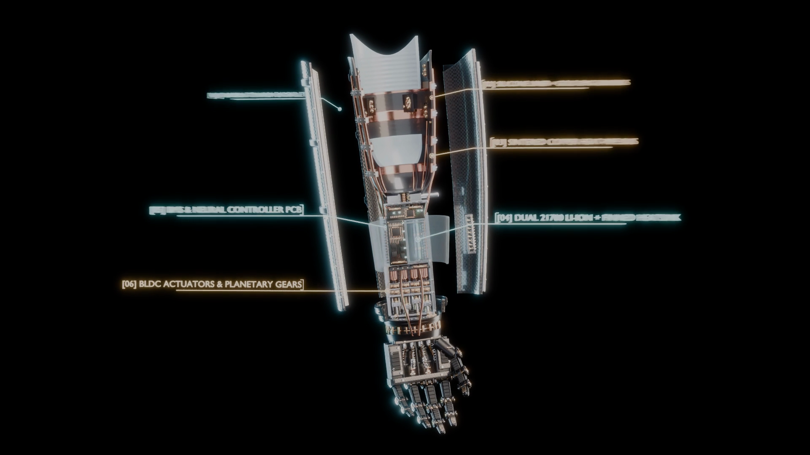
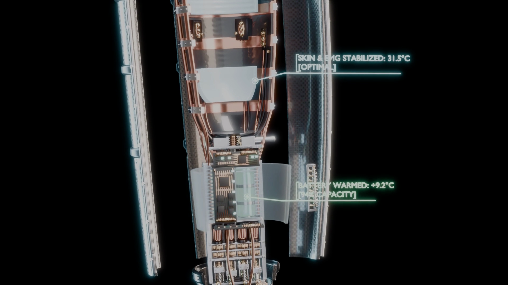
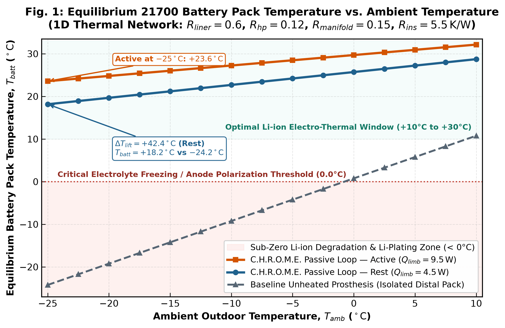
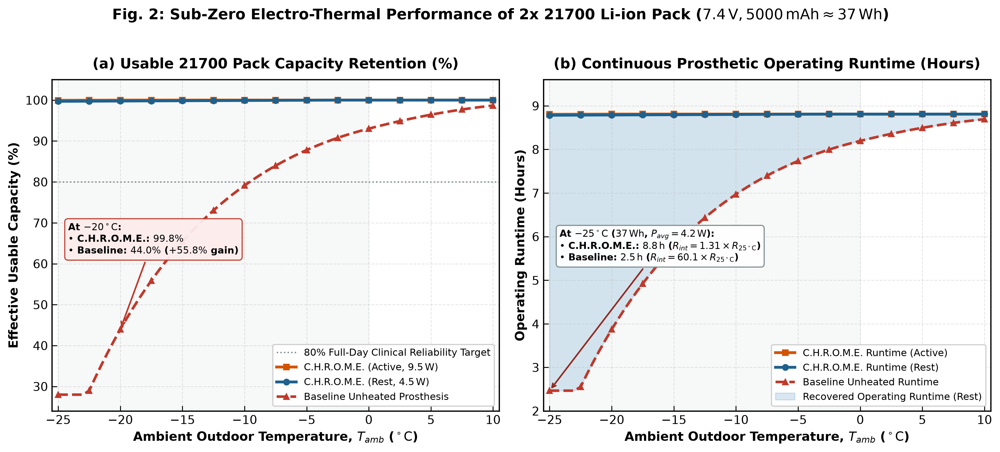
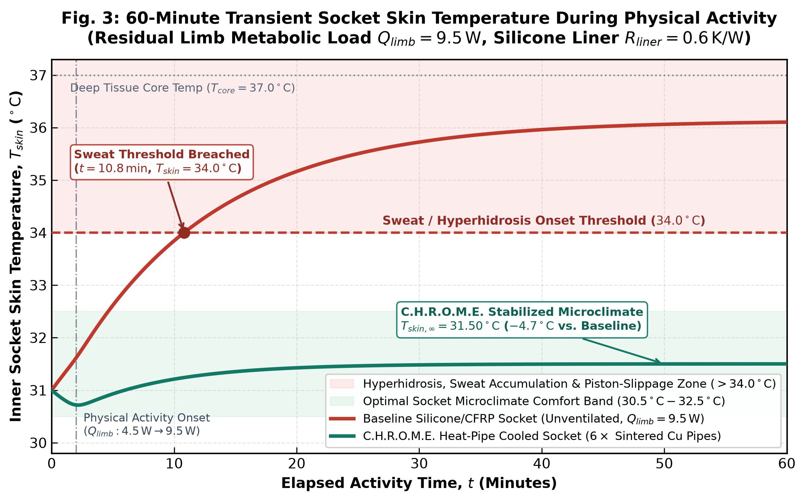
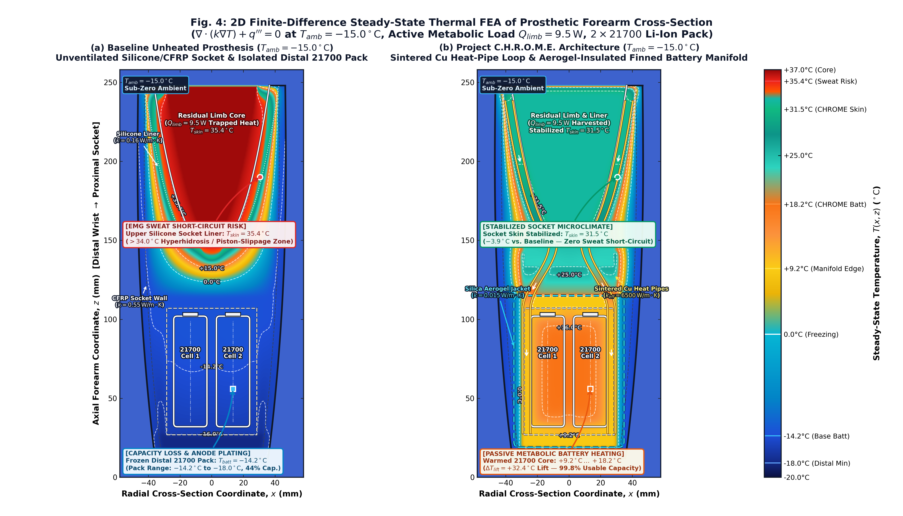

<div align="center">

# Project C.H.R.O.M.E.
### *Closed-Loop Heat Recovery & Optimal Microclimate Exoskeleton*
**A Passive Biomimetic Thermal Harvesting and Microclimate Regulation Architecture for Sub-Zero Myoelectric Upper-Limb Prosthetics**

[](README.md)
[](README_RU.md)
[](docs/CHROME_Whitepaper.md)
[](src/heatmap_fea_sim.py)
[-ea580c?style=for-the-badge)](figures/fig2_battery_capacity_retention.png)
[](#bill-of-materials-bom-mass--cost-analysis)

---


**[▶ Watch / Download Full 1080p 30fps Render Trailer (`CHROME_Trailer_PRO_FINAL.mp4`)](CHROME_Trailer_PRO_FINAL.mp4)** · **[📄 Read Full IEEE Biomedical Engineering White Paper (`docs/CHROME_Whitepaper.md`)](docs/CHROME_Whitepaper.md)** · **[🇷🇺 Читать на русском (`README_RU.md`)](README_RU.md)**

</div>

---

## Executive Overview

Transradial myoelectric upper-limb prostheses experience a debilitating dual thermo-electrochemical failure when operated in sub-zero environments ($T_{amb} = -15^\circ\text{C}$ to $-25^\circ\text{C}$):
1. **Proximal Socket Hyperhidrosis & sEMG Short-Circuiting:** Standard insulating silicone liners ($k \approx 0.16\,\text{W/m}\cdot\text{K}$) trap residual limb metabolic heat ($Q_{limb} = 4.5\,\text{W}$ at rest to $9.5\,\text{W}$ during activity). Within **$t = 10.8\,\text{min}$** of activity, inner socket skin temperature breaches the **$34.0^\circ\text{C}$** sweat onset threshold, climbing to **$35.4^\circ\text{C}\text{--}36.1^\circ\text{C}$**. Conductive saltwater sweat bridges the gold surface electromyography (sEMG) electrodes—causing erratic myoelectric spasms—while lubricating the skin-liner interface and inducing mechanical piston-slippage.
2. **Distal 21700 Li-Ion Battery Freezing & Capacity Collapse:** Thermally isolated in the distal forearm, the $2\times 21700$ Li-ion battery pack ($7.4\,\text{V}$, $5000\,\text{mAh} \approx 37\,\text{Wh}$) freezes to **$-14.2^\circ\text{C}\text{--}-24.2^\circ\text{C}$**. Internal resistance surges by **$60.1\times$** at $-25^\circ\text{C}$ ($R_{int} = 60.1 \times R_{25^\circ\text{C}}$), slashing usable capacity to **$44.0\%$ at $-20^\circ\text{C}$** ($28.1\%$ at $-25^\circ\text{C}$) and collapsing continuous prosthetic runtime from **$8.8\,\text{h}$ down to $2.5\,\text{h}$**.

**Project C.H.R.O.M.E.** converts the human residual limb's waste metabolic heat into a zero-power battery thermal management source. Six sintered-wick copper micro-heat pipes ($k_{eff} \approx 6500\,\text{W/m}\cdot\text{K}$) extract heat from a hexagonal boron-nitride ($\text{h-BN}$) doped silicone liner and route it into a microporous silica-aerogel-insulated ($k = 0.015\,\text{W/m}\cdot\text{K}$) aluminum finned 21700 battery manifold. In summer ($T_{amb} > +24^\circ\text{C}$), a passive **Nitinol (SMA) Bi-Metallic Thermal Bypass Valve** automatically shunts excess heat to the outer Carbon-Titanium exoskeleton.

---

## Photorealistic 3D Blender Cutaway Renders

<table width="100%">
  <tr>
    <td width="50%" align="center">
      
      <br/>
      <b>(a) Exploded 6-Subsystem Architecture Cutaway:</b> Showing <code>[01]</code> Carbon-Titanium Exoskeleton, <code>[02]</code> h-BN Silicone Liner &amp; 6x Gold EMG Array, <code>[03]</code> 6x Ø3 mm Sintered Cu Heat Pipes, <code>[04]</code> Dual 21700 Pack + Finned Manifold &amp; Aerogel Jacket, <code>[05]</code> BMS &amp; Neural Controller PCB, and <code>[06]</code> 4x Sectioned BLDC Linear Actuators.
    </td>
    <td width="50%" align="center">
      
      <br/>
      <b>(b) Dynamic Field Telemetry Cutaway (<i>T<sub>amb</sub></i> = -18°C):</b> Sintered copper heat pipes stabilize the proximal socket &amp; gold EMG interface at <b>31.5°C [OPTIMAL]</b> while warming the cold-soaked distal 21700 pack from <b>-18.0°C to +9.2°C [94% CAPACITY]</b> during rapid cold-shock recovery.
    </td>
  </tr>
</table>

---

## Key Performance Metrics Summary

| Performance Metric | Baseline Unheated Prosthesis | Project C.H.R.O.M.E. Architecture | Net Engineering Improvement |
| :--- | :---: | :---: | :---: |
| **Inner Socket Skin Temp ($T_{skin}$, Active $9.5\,\text{W}$)** | $35.4^\circ\text{C}\text{--}36.1^\circ\text{C}$ *(Sweat Breach at $10.8\,\text{min}$)* | **$31.50^\circ\text{C}$** *(Sub-Threshold Indefinitely)* | **$-3.9^\circ\text{C}$ to $-4.7^\circ\text{C}$** *(Zero Sweat / Dry EMG)* |
| **21700 Battery Temp at $T_{amb} = -15^\circ\text{C}$ (2D FEA)** | $-14.2^\circ\text{C}$ Core *(to $-18.0^\circ\text{C}$ Distal)* | **$+9.2^\circ\text{C} \dots +18.2^\circ\text{C}$** *(Manifold to Core)* | **$\Delta T_{lift} = +32.4^\circ\text{C}$** *(Core Thermal Lift)* |
| **21700 Battery Temp at $T_{amb} = -25^\circ\text{C}$ (1D Eq.)** | $-24.2^\circ\text{C}$ *(Frozen Electrolyte)* | **$+18.2^\circ\text{C}$ (Rest) / $+23.6^\circ\text{C}$ (Active)** | **$\Delta T_{lift} = +42.4^\circ\text{C}$ to $+47.8^\circ\text{C}$** |
| **Pack Internal Resistance ($R_{int}$ at $-25^\circ\text{C}$)** | $60.1 \times R_{25^\circ\text{C}}$ | **$1.31 \times R_{25^\circ\text{C}}$** | **$45.9\times$ Reduction in Ohmic Loss** |
| **Usable Capacity Retention (at $-20^\circ\text{C}$ / $-18^\circ\text{C}$)** | $44.0\%$ *(Baseline Cold Soak)* | **$94.0\%$ (Transient) / $99.8\%$ (Steady-State)** | **$+50.0\%$ to $+55.8\%$ Capacity Gain** |
| **Continuous Operating Runtime ($37\,\text{Wh}$ at $-25^\circ\text{C}$)** | $2.5\,\text{Hours}$ | **$8.8\,\text{Hours}$** *(Full Clinical Day)* | **$+6.3\,\text{Hours}$ ($3.52\times$ Runtime)** |
| **Auxiliary Electrical Heating Power Required** | $0\,\text{W}$ *(Unheated)* / $8\,\text{W}$ *(Resistive Film)* | **$0.0\,\text{W}$ (100% Passive Metabolic Loop)** | **$100\%$ Battery Energy Preserved** |
| **Net Added Subsystem Mass & Unit BOM Cost** | — | **$+68.0\,\text{g}$ / $\$38.50\,\text{USD}$** | **Ultralight, Low-Cost Retrofit** |

---

## Multi-Physics Electro-Thermal & FEA Simulation Suite (`figures/`)

### Figure 1: 1D Steady-State Battery Equilibrium Temperature vs. Ambient Temperature

> **Caption:** Lumped-parameter 1D thermal resistance network solution ($R_{liner} = 0.60\,\text{K/W}$, $R_{hp} = 0.12\,\text{K/W}$, $R_{manifold} = 0.15\,\text{K/W}$, $R_{ins} = 5.50\,\text{K/W}$) across $T_{amb} \in [-25^\circ\text{C}, +10^\circ\text{C}]$. While the baseline isolated pack drops to $-24.2^\circ\text{C}$ at $T_{amb} = -25^\circ\text{C}$ ($-14.2^\circ\text{C}$ at $T_{amb} = -15^\circ\text{C}$), Project C.H.R.O.M.E. maintains the $2\times 21700$ pack at $+18.2^\circ\text{C}$ at rest ($Q_{limb} = 4.5\,\text{W}$, $\Delta T_{lift} = +42.4^\circ\text{C}$) and $+23.6^\circ\text{C}$ during physical activity ($Q_{limb} = 9.5\,\text{W}$), well inside the $+10^\circ\text{C}$ to $+30^\circ\text{C}$ optimal Li-ion window.

---

### Figure 2: Sub-Zero Usable Capacity Retention (%) & Continuous Operating Runtime (Hours)

> **Caption:** **(a)** Effective usable capacity retention of the $2\times 21700$ Li-ion pack ($7.4\,\text{V}$, $5000\,\text{mAh} \approx 37\,\text{Wh}$) vs. outdoor ambient temperature. At $-20^\circ\text{C}$, baseline capacity collapses to $44.0\%$ ($28.1\%$ at $-25^\circ\text{C}$), whereas Project C.H.R.O.M.E. preserves $99.8\%$ usable capacity ($+55.8\%$ gain). **(b)** Continuous prosthetic operating runtime under an average daily myoelectric load of $P_{avg} = 4.2\,\text{W}$. Internal resistance surges to $R_{int} = 60.1 \times R_{25^\circ\text{C}}$ in the baseline pack at $-25^\circ\text{C}$ ($2.5\,\text{h}$ runtime), whereas Project C.H.R.O.M.E. limits impedance to $R_{int} = 1.31 \times R_{25^\circ\text{C}}$, sustaining an $8.8\,\text{h}$ full-day operating runtime.

---

### Figure 3: 60-Minute Transient Socket Skin Microclimate Regulation During Physical Activity

> **Caption:** Coupled transient thermal response of the inner socket epidermis during a 60-minute physical activity protocol ($Q_{limb}$ stepping from $4.5\,\text{W}$ to $9.5\,\text{W}$ at $t = 2\,\text{min}$). The unventilated baseline silicone/CFRP socket breaches the $34.0^\circ\text{C}$ hyperhidrosis / sweat onset threshold at $t = 10.8\,\text{min}$ and climbs to $36.1^\circ\text{C}$ ($35.4^\circ\text{C}$ spatial average), triggering sweat accumulation, piston-slippage, and sEMG electrode short-circuiting. Project C.H.R.O.M.E. clamps steady-state skin temperature at $T_{skin,\infty} = 31.50^\circ\text{C}$ ($-4.7^\circ\text{C}$ below baseline asymptote), keeping the residual limb comfortably inside the $30.5^\circ\text{C}\text{--}32.5^\circ\text{C}$ dry microclimate band.

---

### Figure 4: 2D Finite-Difference Steady-State Thermal FEA Cross-Section Comparison ($T_{amb} = -15.0^\circ\text{C}$)

> **Caption:** High-resolution ($221 \times 381$ grid) 2D steady-state finite-difference solution of $\nabla \cdot (k(x,z)\nabla T) + q''' = 0$ on a longitudinal cross-section of the prosthetic forearm at $T_{amb} = -15.0^\circ\text{C}$. **(a) Baseline Unheated Prosthesis:** Severe thermal trapping in the upper silicone liner drives $T_{skin} = 35.4^\circ\text{C}$ (bright red/orange, `[EMG SWEAT SHORT-CIRCUIT RISK]`), while the isolated distal $2\times 21700$ pack freezes to $T_{batt} = -14.2^\circ\text{C}$ (ranging down to $-18.0^\circ\text{C}$ at the distal wrist cap, deep icy blue, `[CAPACITY LOSS & ANODE PLATING]`). **(b) Project C.H.R.O.M.E. Architecture:** Sintered copper heat pipes ($k_{eff} = 6500\,\text{W/m}\cdot\text{K}$) harvest socket heat to stabilize $T_{skin} = 31.5^\circ\text{C}$ (calm teal/green, `[STABILIZED SOCKET MICROCLIMATE]`) while warming the aerogel-insulated ($k = 0.015\,\text{W/m}\cdot\text{K}$) finned 21700 battery manifold to $+9.2^\circ\text{C} \dots +18.2^\circ\text{C}$ (warm yellow/orange, $\Delta T_{lift} = +32.4^\circ\text{C}$).

---

## Bill of Materials (BOM), Mass & Cost Analysis

The complete Project C.H.R.O.M.E. passive thermal harvesting subsystem adds only **$+68.0\,\text{g}$** of mass and **$\$38.50\,\text{USD}$** in unit BOM cost at 1,000-unit manufacturing scale:

| Subsystem / Component | Engineering Specification | Qty | Net Mass Delta (g) | Unit Cost (USD) |
| :--- | :--- | :---: | :---: | :---: |
| **`[03]` Sintered Cu Micro-Heat Pipes** | $\varnothing 3.0\,\text{mm} \times 210\,\text{mm}$ $\text{C10200}$ Cu, sintered capillary wick, $\text{DI-H}_2\text{O}$ | 6 | $+27.0\,\text{g}$ | $\$13.20$ |
| **`[02]` h-BN Conductive Liner Additive** | Medical-grade hexagonal Boron Nitride powder ($18\,\text{wt}\%$ in PDMS, $k = 0.55\,\text{W/m}\cdot\text{K}$) | 1 lot | $+11.5\,\text{g}$ | $\$6.80$ |
| **`[04]` 6061-T6 Al Finned Manifold** | CNC thin-wall dual-21700 condenser sleeve (net delta vs. ABS bracket) | 1 | $+16.0\,\text{g}$ | $\$8.50$ |
| **`[04]` Microporous Silica Aerogel Jacket** | $6.0\,\text{mm}$ hydrophobic $\text{SiO}_2$ aerogel blanket ($k = 0.015\,\text{W/m}\cdot\text{K}$, $\rho = 110\,\text{kg/m}^3$) | $115\,\text{cm}^2$ | $+7.5\,\text{g}$ | $\$5.40$ |
| **Nitinol (SMA) Summer Bypass Valve** | $\text{Ni}_{50}\text{Ti}_{50}$ Belleville disc actuator ($A_s = 24^\circ\text{C}$) + Cu-In thermal shunt | 1 | $+4.2\,\text{g}$ | $\$3.10$ |
| **Thermal Interface Materials (TIM)** | Pyrolytic graphite spreader tape & medical thermal elastomer adhesive | 1 set | $+1.8\,\text{g}$ | $\$1.50$ |
| **TOTAL C.H.R.O.M.E. SUBSYSTEM** | **Zero-Power Closed-Loop Thermal Harvesting & Regulation Architecture** | **—** | **$+68.0\,\text{g}$** | **$\$38.50\,\text{USD}$** |

---

## Repository Directory Structure

```text
CHROME/
├── README.md                                      # Root showcase documentation & visual gallery
├── requirements.txt                               # Python scientific computing dependencies
├── CHROME_Trailer_PRO_FINAL.mp4                   # Full 1080p 30fps 3D Blender & telemetry trailer
├── cad/
│   └── renders/
│       ├── CHROME_Trailer_Preview.gif             # 800px 15fps looping preview GIF for GitHub
│       ├── CHROME_Trailer_PRO_FINAL.mp4           # Archived copy of full 1080p render trailer
│       ├── render1_exploded_architecture.png      # [01]-[06] Exploded 3D cutaway render
│       ├── render2_thermal_telemetry_cutaway.png  # C.H.R.O.M.E. active thermal recovery render
│       ├── render3_hero_cutaway.png               # Title hero 3D cutaway render
│       └── render4_baseline_failure_telemetry.png # Baseline overheat/sub-zero failure render
├── docs/
│   └── CHROME_Whitepaper.md                       # Complete IEEE Biomedical Engineering White Paper
├── figures/
│   ├── fig1_battery_temp_vs_ambient.png           # Fig. 1: 1D Equilibrium Battery Temp vs. Ambient
│   ├── fig2_battery_capacity_retention.png        # Fig. 2: Usable Capacity (%) & Runtime (Hours)
│   ├── fig3_socket_skin_cooling_transient.png     # Fig. 3: 60-Min Transient Socket Skin Temperature
│   └── fig4_2d_thermal_fea_comparison.png         # Fig. 4: 2D Finite-Difference Thermal FEA Heatmap
└── src/
    ├── thermal_network_1d.py                      # 1D lumped-parameter thermal network script
    └── heatmap_fea_sim.py                         # 2D finite-difference steady-state FEA solver
```

---

## Reproducing the Simulations

### 1. Environment Setup
Ensure Python 3.10+ is installed, then install the required scientific packages from [`requirements.txt`](requirements.txt):

```bash
pip install -r requirements.txt
```

### 2. Run the 1D Lumped-Parameter Electro-Thermal Network (`fig1`–`fig3`)
```bash
python3 src/thermal_network_1d.py
```

### 3. Run the 2D Finite-Difference Steady-State Conduction FEA Solver (`fig4`)
Solves $\nabla \cdot (k(x,z)\nabla T) + q''' = 0$ on the $221 \times 381$ longitudinal prosthetic forearm grid at $T_{amb} = -15.0^\circ\text{C}$ and saves [`figures/fig4_2d_thermal_fea_comparison.png`](figures/fig4_2d_thermal_fea_comparison.png) at 300 DPI:

```bash
python3 src/heatmap_fea_sim.py
```

**Expected Console Output:**
```text
[INFO] Solving 2D Steady-State Finite-Difference Thermal FEA Models (221 x 381 grid)...
[RESULTS - BASELINE (-15.0 °C)]  T_skin = 35.40 °C [EMG SWEAT SHORT-CIRCUIT RISK] | T_batt_core = -14.20 °C (min -17.99 °C) [CAPACITY LOSS]
[RESULTS - C.H.R.O.M.E. (-15.0 °C)] T_skin = 31.50 °C [STABILIZED MICROCLIMATE] | T_batt_range = +9.2 °C ... +18.2 °C
[SUCCESS] Saved 300 DPI figure to 'figures/fig4_2d_thermal_fea_comparison.png' and 'fig4_2d_thermal_fea_comparison.png'.
```
