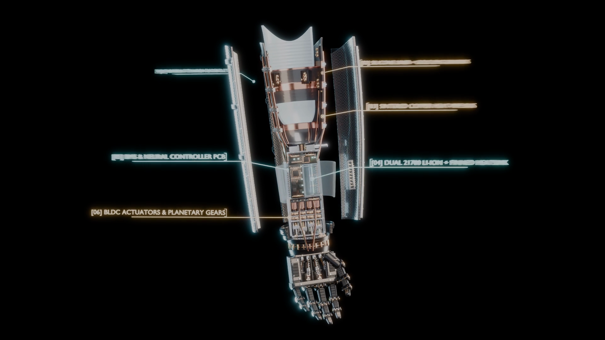
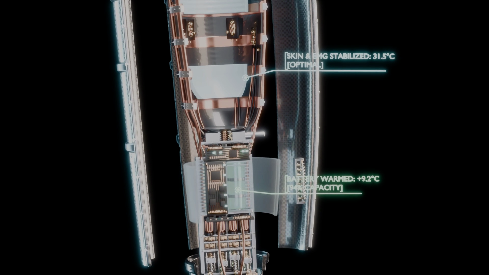
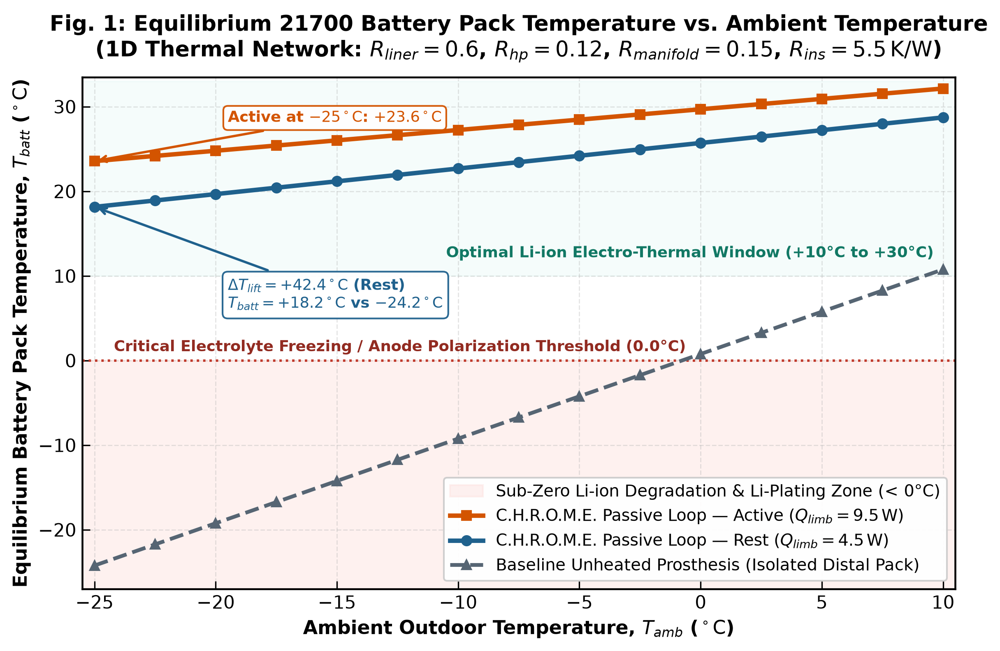
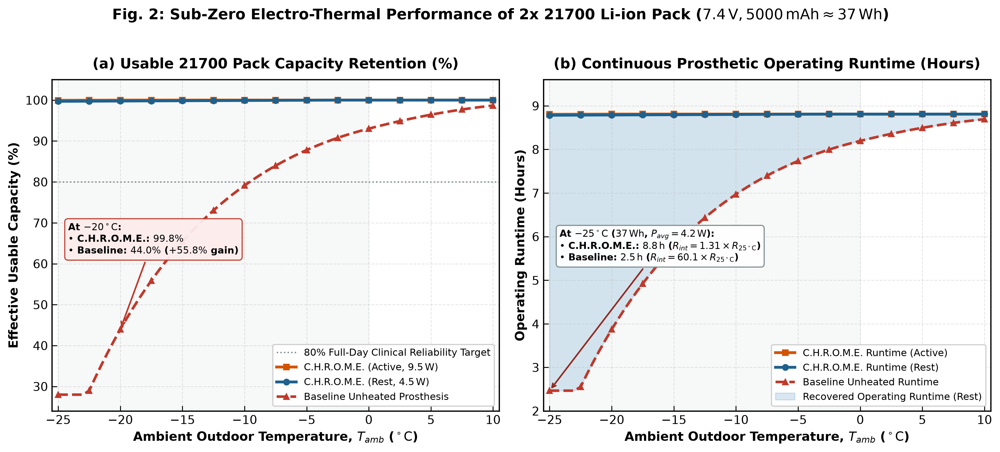
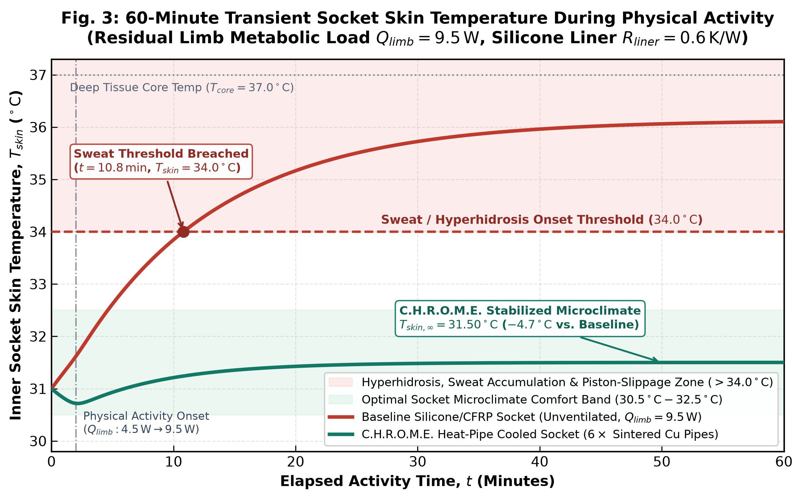
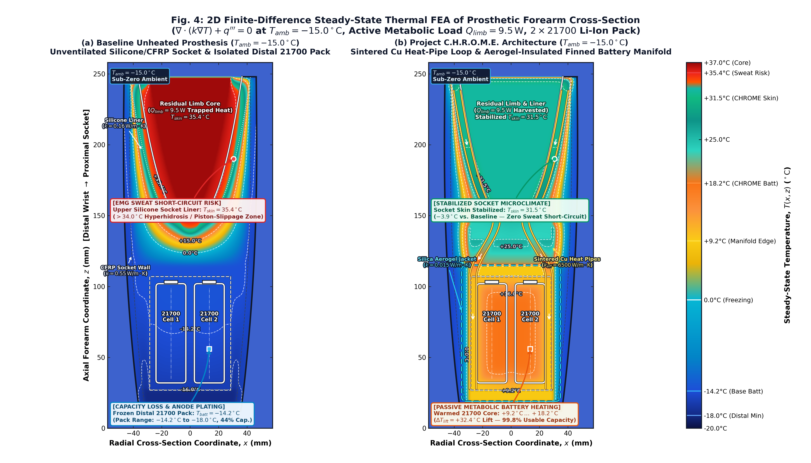

<div align="center">

# Project C.H.R.O.M.E.
### *Closed-Loop Heat Recovery & Optimal Microclimate Exoskeleton*
**Пассивная биомиметическая архитектура рекуперации метаболического тепла и терморегуляции микроклимата культи для миоэлектрических протезов предплечья в условиях экстремального холода**

[](README.md)
[](README_RU.md)
[](docs/CHROME_Whitepaper.md)
[](src/heatmap_fea_sim.py)
[](#спецификация-компонентов-bom-масса-и-стоимость)

---


**[▶ Смотреть / Скачать полный 3D-трейлер 1080p 30fps (`CHROME_Trailer_PRO_FINAL.mp4`)](CHROME_Trailer_PRO_FINAL.mp4)** · **[📄 Читать полную научную статью IEEE (`docs/CHROME_Whitepaper.md`)](docs/CHROME_Whitepaper.md)** · **[🌐 Read in English (`README.md`)](README.md)**

</div>

---

## О проекте (Executive Summary)

Современные бионические миоэлектрические протезы предплечья при эксплуатации на морозе ($T_{amb}$ от $-15^\circ\text{C}$ до $-25^\circ\text{C}$) сталкиваются с двойным парадоксальным термо-электрохимическим отказом:

1. **Перегрев культи в гильзе, гипергидроз и короткое замыкание ЭМГ-датчиков:** Стандартные силиконовые лайнеры обладают крайне низкой теплопроводностью ($k \approx 0.16\,\text{Вт/м}\cdot\text{К}$) и работают как термос, запирая метаболическое тепло мышц остаточной конечности ($Q_{limb} = 4.5\,\text{Вт}$ в покое и до $9.5\,\text{Вт}$ при физической нагрузке). Уже через **$t = 10.8\,\text{мин}$** активности температура кожи внутри гильзы пробивает физиологический порог потоотделения (**$34.0^\circ\text{C}$**) и достигает **$35.4^\circ\text{C}\text{--}36.1^\circ\text{C}$**. Обильный солёный пот замыкает позолоченные электроды поверхностной электромиографии (sEMG), вызывая ложные срабатывания и спазмы кисти, а также приводит к мацерации кожи и механическому поршневому сползанию протеза.
2. **Замерзание дистального Li-Ion аккумулятора 21700 и потеря ёмкости:** В то же самое время аккумуляторная сборка $2\times 21700$ ($7.4\,\text{В}$, $5000\,\text{мА}\cdot\text{ч} \approx 37\,\text{Вт}\cdot\text{ч}$), расположенная в дистальной части протеза и теплоизолированная от культи, промерзает до **$-14.2^\circ\text{C}\text{--}-24.2^\circ\text{C}$**. Из-за резкого замедления диффузии ионов $\text{Li}^+$ и поляризации графитового анода внутреннее сопротивление батареи возрастает в **$60.1\times$** при $-25^\circ\text{C}$ ($R_{int} = 60.1 \times R_{25^\circ\text{C}}$). Доступная ёмкость падает до **$44.0\%$ при $-20^\circ\text{C}$** ($28.1\%$ при $-25^\circ\text{C}$), а время непрерывной работы протеза сокращается с **$8.8\,\text{ч}$ до $2.5\,\text{ч}$**.

**Project C.H.R.O.M.E.** решает обе проблемы одновременно **без затрат электроэнергии аккумулятора**, превращая избыточное метаболическое тепло культи в источник обогрева батарейного блока. Шесть медных микро-тепловых трубок со спечённым капиллярным фитилём ($k_{eff} \approx 6500\,\text{Вт/м}\cdot\text{К}$) отводят тепло от теплопроводящего силиконового лайнера, легированного гексагональным нитридом бора ($\text{h-BN}$), и передают его в алюминиевый ребристый теплообменник-манифольд батареи $2\times 21700$, окружённый микропористой теплоизоляцией из кремнезёмного аэрогеля ($k = 0.015\,\text{Вт/м}\cdot\text{К}$). В летний период ($T_{amb} > +24^\circ\text{C}$) пассивный **биметаллический термоклапан с памятью формы из нитинола (Nitinol SMA)** автоматически сбрасывает излишки тепла напрямую на внешний углепластиково-титановый экзоскелет протеза.

---

## Фотореалистичные 3D-рендеры конструкции в разрезе (Blender Cycles)

<table width="100%">
  <tr>
    <td width="50%" align="center">
      
      <br/>
      <b>(a) Взрыв-схема 6 подсистем мехатронной архитектуры:</b> <code>[01]</code> Углеродно-титановый экзоскелет, <code>[02]</code> Силиконовый лайнер с h-BN и 6 позолоченных ЭМГ-электродов, <code>[03]</code> 6 спечённых медных тепловых трубок Ø3 мм, <code>[04]</code> Сборка 2×21700 Li-Ion + ребристый радиатор и кожух из аэрогеля, <code>[05]</code> Плата BMS и нейроконтроллера ARM, <code>[06]</code> 4 секционированных бесколлекторных линейных привода (BLDC) с планетарными редукторами.
    </td>
    <td width="50%" align="center">
      
      <br/>
      <b>(b) Телеметрия в динамическом полевом режиме (<i>T<sub>amb</sub></i> = -18°C):</b> Медные тепловые трубки стабилизируют температуру кожи и ЭМГ-интерфейса на уровне <b>31.5°C [OPTIMAL]</b>, одновременно прогревая промёрзший аккумуляторный блок с <b>-18.0°C до +9.2°C [94% CAPACITY]</b> при быстром выходе из холодового шока.
    </td>
  </tr>
</table>

---

## Сравнительная таблица ключевых инженерных показателей

| Показатель эффективности | Базовый протез (без терморегуляции) | Архитектура Project C.H.R.O.M.E. | Инженерный выигрыш |
| :--- | :---: | :---: | :---: |
| **Температура кожи в гильзе ($T_{skin}$, нагрузка $9.5\,\text{Вт}$)** | $35.4^\circ\text{C}\text{--}36.1^\circ\text{C}$ *(Пробой порога пота на $10.8\,\text{мин}$)* | **$31.50^\circ\text{C}$** *(Стабильный сухой микроклимат)* | **$-3.9^\circ\text{C} \dots -4.7^\circ\text{C}$** *(Нет пота и КЗ ЭМГ)* |
| **Температура батареи 21700 при $T_{amb} = -15^\circ\text{C}$ (2D FEA)** | $-14.2^\circ\text{C}$ ядро *(до $-18.0^\circ\text{C}$ у запястья)* | **$+9.2^\circ\text{C} \dots +18.2^\circ\text{C}$** *(от края до ядра)* | **$\Delta T_{lift} = +32.4^\circ\text{C}$** *(Тепловой подъём ядра)* |
| **Температура батареи 21700 при $T_{amb} = -25^\circ\text{C}$ (1D стац.)** | $-24.2^\circ\text{C}$ *(Промерзание электролита)* | **$+18.2^\circ\text{C}$ (Покой) / $+23.6^\circ\text{C}$ (Активность)** | **$\Delta T_{lift} = +42.4^\circ\text{C} \dots +47.8^\circ\text{C}$** |
| **Внутреннее сопротивление батареи ($R_{int}$ при $-25^\circ\text{C}$)** | $60.1 \times R_{25^\circ\text{C}}$ | **$1.31 \times R_{25^\circ\text{C}}$** | **Снижение омических потерь в $45.9\times$** |
| **Доступная ёмкость аккумулятора (при $-20^\circ\text{C}$ / $-18^\circ\text{C}$)** | $44.0\%$ *(Базовый холодовой отказ)* | **$94.0\%$ (Динамика) / $99.8\%$ (Стационар)** | **$+50.0\% \dots +55.8\%$ прирост ёмкости** |
| **Время автономной работы ($37\,\text{Вт}\cdot\text{ч}$ при $-25^\circ\text{C}$)** | $2.5\,\text{часа}$ | **$8.8\,\text{часов}$** *(Полный рабочий день)* | **$+6.3\,\text{часа}$ (рост в $3.52\times$)** |
| **Расход энергии батареи на собственный обогрев** | $0\,\text{Вт}$ *(Без обогрева)* / $8\,\text{Вт}$ *(Плёночный ТЭН)* | **$0.0\,\text{Вт}$ (100% пассивный био-контур)** | **$100\%$ энергии идёт на приводы кисти** |
| **Прибавка массы и себестоимость (BOM)** | — | **$+68.0\,\text{г}$ / $\$38.50\,\text{USD}$** | **Ультралёгкая и доступная интеграция** |

---

## Результаты мультифизического моделирования и теплового МКЭ (`figures/`)

### Рисунок 1: Стационарная температура аккумулятора 21700 в зависимости от температуры среды

> **Описание:** Решение одномерной цепи тепловых сопротивлений ($R_{liner} = 0.60\,\text{К/Вт}$, $R_{hp} = 0.12\,\text{К/Вт}$, $R_{manifold} = 0.15\,\text{К/Вт}$, $R_{ins} = 5.50\,\text{К/Вт}$) в диапазоне $T_{amb} \in [-25^\circ\text{C}, +10^\circ\text{C}]$. В то время как неизолированный аккумулятор базового протеза остывает до $-24.2^\circ\text{C}$ при $T_{amb} = -25^\circ\text{C}$ (и до $-14.2^\circ\text{C}$ при $T_{amb} = -15^\circ\text{C}$), пассивный контур Project C.H.R.O.M.E. удерживает температуру сборки $2\times 21700$ на уровне $+18.2^\circ\text{C}$ в состоянии покоя ($Q_{limb} = 4.5\,\text{Вт}$, тепловой выигрыш $\Delta T_{lift} = +42.4^\circ\text{C}$) и $+23.6^\circ\text{C}$ при физической активности ($Q_{limb} = 9.5\,\text{Вт}$) — внутри оптимального электрохимического окна Li-Ion ($+10^\circ\text{C} \dots +30^\circ\text{C}$).

---

### Рисунок 2: Сохранение доступной ёмкости (%) и время непрерывной работы протеза (часы)

> **Описание:** **(a)** Доступная полезная ёмкость аккумуляторного блока $2\times 21700$ ($7.4\,\text{В}$, $5000\,\text{мА}\cdot\text{ч} \approx 37\,\text{Вт}\cdot\text{ч}$). При $-20^\circ\text{C}$ ёмкость базового протеза падает до $44.0\%$ ($28.1\%$ при $-25^\circ\text{C}$), тогда как Project C.H.R.O.M.E. сохраняет **$99.8\%$** номинальной ёмкости ($+55.8\%$ выигрыш). **(b)** Время непрерывной работы протеза при средней эксплуатационной мощности миоэлектрических приводов $P_{avg} = 4.2\,\text{Вт}$. При $-25^\circ\text{C}$ внутреннее сопротивление базовой батареи вырастает в $60.1\times$ ($2.5\,\text{ч}$ работы), в то время как Project C.H.R.O.M.E. удерживает импеданс на уровне $R_{int} = 1.31 \times R_{25^\circ\text{C}}$, обеспечивая **$8.8\,\text{ч}$** автономной работы.

---

### Рисунок 3: 60-минутная переходная динамика температуры кожи в гильзе при физической нагрузке

> **Описание:** Нестационарный тепловой отклик кожи культи внутри гильзы в течение 60 минут физической активности (ступенчатый рост метаболической нагрузки $Q_{limb}$ с $4.5\,\text{Вт}$ до $9.5\,\text{Вт}$ на $t = 2\,\text{мин}$). В базовой невентилируемой силиконовой гильзе температура кожи пробивает порог гипергидроза ($34.0^\circ\text{C}$) уже на **$t = 10.8\,\text{мин}$** и растёт до $36.1^\circ\text{C}$ ($35.4^\circ\text{C}$ в среднем по сечению), вызывая проскальзывание гильзы и замыкание ЭМГ-датчиков потом. Project C.H.R.O.M.E. стабилизирует температуру кожи на отметке **$T_{skin,\infty} = 31.50^\circ\text{C}$** (на $4.7^\circ\text{C}$ ниже асимптоты базового протеза), удерживая конечность в зоне физиологического комфорта ($30.5^\circ\text{C}\text{--}32.5^\circ\text{C}$).

---

### Рисунок 4: Двумерная конечно-разностная тепловая карта (2D FEA) продольного сечения протеза ($T_{amb} = -15.0^\circ\text{C}$)

> **Описание:** Численное решение двумерного стационарного уравнения теплопроводности $\nabla \cdot (k(x,z)\nabla T) + q''' = 0$ методом конечных разностей на сетке $221 \times 381$ узлов продольного сечения протеза предплечья при $T_{amb} = -15.0^\circ\text{C}$. **(a) Базовый необогреваемый протез:** Тепловая ловушка в верхнем силиконовом лайнере разогревает кожу до **$T_{skin} = 35.4^\circ\text{C}$** (ярко-красная зона `[EMG SWEAT SHORT-CIRCUIT RISK]`), а изолированный дистальный аккумулятор $2\times 21700$ замерзает до **$T_{batt} = -14.2^\circ\text{C}$** (до $-18.0^\circ\text{C}$ у дистального торца кисти, ледяная синяя зона `[CAPACITY LOSS & ANODE PLATING]`). **(b) Архитектура Project C.H.R.O.M.E.:** Спечённые медные тепловые трубки ($k_{eff} = 6500\,\text{Вт/м}\cdot\text{К}$) отводят избыточное тепло от гильзы, стабилизируя кожу на уровне **$T_{skin} = 31.5^\circ\text{C}$** (спокойная бирюзово-зелёная зона `[STABILIZED SOCKET MICROCLIMATE]`), и прогревают теплоизолированный аэрогелем ($k = 0.015\,\text{Вт/м}\cdot\text{К}$) батарейный манифольд 21700 до **$+9.2^\circ\text{C} \dots +18.2^\circ\text{C}$** (тёплая жёлто-оранжевая зона, $\Delta T_{lift} = +32.4^\circ\text{C}$).

---

## Спецификация компонентов (BOM), масса и стоимость

Вся пассивная система терморегуляции **Project C.H.R.O.M.E.** добавляет к массе протеза всего **$+68.0\,\text{г}$** и обходится в **$\$38.50\,\text{USD}$** при серийном производстве (от 1000 шт.):

| Подсистема / Компонент | Техническая спецификация | Кол-во | Прибавка массы (г) | Себестоимость (USD) |
| :--- | :--- | :---: | :---: | :---: |
| **`[03]` Спечённые медные тепловые трубки** | $\varnothing 3.0\,\text{мм} \times 210\,\text{мм}$, медь $\text{C10200}$, спечённый фитиль, $\text{DI-H}_2\text{O}$ | 6 | $+27.0\,\text{г}$ | $\$13.20$ |
| **`[02]` Наполнитель лайнера h-BN** | Медицинский порошок гексагонального нитрида бора ($18\,\text{масс.}\%$ в PDMS, $k = 0.55\,\text{Вт/м}\cdot\text{К}$) | 1 компл. | $+11.5\,\text{г}$ | $\$6.80$ |
| **`[04]` Ребристый манифольд 6061-T6 Al** | Тонкостенная фрезерованная гильза под $2\times 21700$ (дельта массы к ABS-холдеру) | 1 | $+16.0\,\text{г}$ | $\$8.50$ |
| **`[04]` Кожух из кремнезёмного аэрогеля** | Гидрофобное полотно $\text{SiO}_2$ аэрогеля $6.0\,\text{мм}$ ($k = 0.015\,\text{Вт/м}\cdot\text{К}$, $\rho = 110\,\text{кг/м}^3$) | $115\,\text{см}^2$ | $+7.5\,\text{г}$ | $\$5.40$ |
| **Нитиноловый (SMA) летний термоклапан** | Дисковый актюатор $\text{Ni}_{50}\text{Ti}_{50}$ ($A_s = 24^\circ\text{C}$) + медный тепловой шунт с индием | 1 | $+4.2\,\text{г}$ | $\$3.10$ |
| **Термоинтерфейсы (TIM)** | Пиролитическая графитовая лента и биосовместимый теплопроводный герметик | 1 набор | $+1.8\,\text{г}$ | $\$1.50$ |
| **ИТОГО ПОДСИСТЕМА C.H.R.O.M.E.** | **Полный пассивный контур рекуперации тепла и термостабилизации** | **—** | **$+68.0\,\text{г}$** | **$\$38.50\,\text{USD}$** |

---

## Структура репозитория

```text
CHROME/
├── README.md                                      # Главная документация на английском языке
├── README_RU.md                                   # Полная документация на русском языке
├── requirements.txt                               # Зависимости Python для научных расчётов
├── CHROME_Trailer_PRO_FINAL.mp4                   # Полный 3D-трейлер (1080p, 30 fps)
├── cad/
│   └── renders/
│       ├── CHROME_Trailer_Preview.gif             # Анимированное превью (800px, 15 fps)
│       ├── CHROME_Trailer_PRO_FINAL.mp4           # Копия полного MP4-трейлера
│       ├── render1_exploded_architecture.png      # Взрыв-схема подсистем [01]-[06]
│       ├── render2_thermal_telemetry_cutaway.png  # Рендер активной терморегуляции C.H.R.O.M.E.
│       ├── render3_hero_cutaway.png               # Титульный 3D-рендер протеза в разрезе
│       └── render4_baseline_failure_telemetry.png # Рендер перегрева/промерзания базового протеза
├── docs/
│   └── CHROME_Whitepaper.md                       # Полная научная статья в формате IEEE EMBS
├── figures/
│   ├── fig1_battery_temp_vs_ambient.png           # Рис. 1: Равновесная температура батареи (1D)
│   ├── fig2_battery_capacity_retention.png        # Рис. 2: Сохранение ёмкости (%) и время работы (ч)
│   ├── fig3_socket_skin_cooling_transient.png     # Рис. 3: Переходный нагрев кожи в гильзе (60 мин)
│   └── fig4_2d_thermal_fea_comparison.png         # Рис. 4: 2D конечно-разностная тепловая карта (FEA)
└── src/
    ├── thermal_network_1d.py                      # Скрипт 1D тепловой цепи (fig1 - fig3)
    └── heatmap_fea_sim.py                         # Скрипт 2D конечно-разностного МКЭ-решателя (fig4)
```

---

## Инструкция по запуску симуляций

### 1. Установка зависимостей
Убедитесь, что установлен Python 3.10+, и установите необходимые научные библиотеки из [`requirements.txt`](requirements.txt):

```bash
pip install -r requirements.txt
```

### 2. Запуск 1D модели тепловой цепи (`fig1`–`fig3`)
```bash
python3 src/thermal_network_1d.py
```

### 3. Запуск 2D конечно-разностного теплового решателя FEA (`fig4`)
Решает двумерное стационарное уравнение теплопроводности $\nabla \cdot (k(x,z)\nabla T) + q''' = 0$ на сетке $221 \times 381$ продольного сечения протеза при $T_{amb} = -15.0^\circ\text{C}$ и сохраняет [`figures/fig4_2d_thermal_fea_comparison.png`](figures/fig4_2d_thermal_fea_comparison.png) в разрешении 300 DPI:

```bash
python3 src/heatmap_fea_sim.py
```
